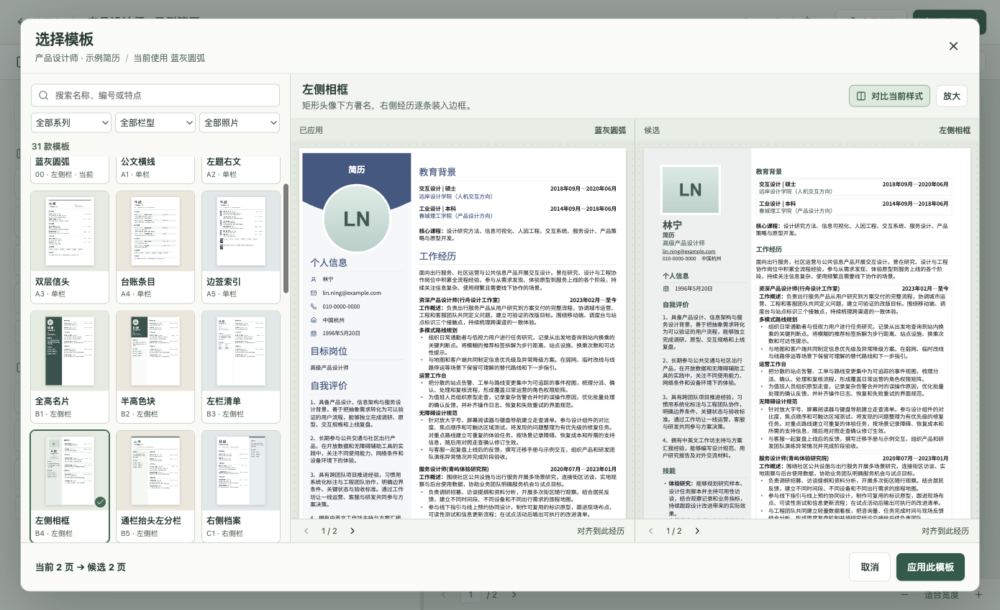

# 简历工坊 · Local Resume Studio

在 Mac 上用左侧表单维护履历，右侧即时预览自己选择的模板。内置 31 款 A4 版式，包括原稿的蓝灰双栏、正式单栏、左右侧栏、时间履历、重点前置和编辑出版系列。完整工作流可离线运行，从复制岗位版本、拖动经历、调整版式到导出可搜索的 A4 PDF。



## 使用

从 [GitHub Releases](https://github.com/franckwei29/local-resume-studio/releases) 下载 Apple Silicon 版，解压后打开「简历工坊」。公开包使用虚构示例。当前分发使用本机 ad-hoc 签名，未经 Apple Developer ID 公证。

1. 在「我的简历」上点卡片的更多菜单，选择「复制」。
2. 打开左侧栏目与记录，修改字段或子项目。抓住六点手柄可以移动内容，更多菜单也提供等价的移动操作。
3. 点右侧「模板」，选一款，用自己的简历逐页试排。点「对比当前样式」可独立翻页或对齐同一段经历，「应用此模板」确认。可以撤销切换；切回用过的模板时会找回其栏位和样式。
4. 在右侧切换页码、缩放或调整排版。点击纸上的文字可定位到左侧表单。
5. 点「导出 PDF」选择保存路径。需要迁移或保留可继续修改的版本时，在简历库导出可编辑备份。

支持从 PDF 和 DOCX 起稿；图像页由 macOS Vision 在本机识别。导入时可以对照来源拆分、合并、跳过或重新归类记录。先核对识别结果，再创建新简历。

## 本地开发

需要 Apple Silicon macOS、Node.js 24、npm 和带 Swift 编译器的 Xcode Command Line Tools。首次安装依赖需要联网。PDF 验收脚本还用到 Poppler 的 pdfinfo、pdftotext 和 pdftoppm。

```sh
npm ci
npm run dev
npm run package
```

开发启动会进行 TypeScript 检查、构建页面、编译本机导入工具，并打开 Electron。打包输出位于 release，包含可双击运行的 .app 与可分发的 ZIP。

## 存储与备份

主进程管理 SQLite 和本机文件对话框，页面在沙箱中运行，外部网络请求受阻。应用数据默认位于用户资源库的 Application Support/简历工坊。RESUME_STUDIO_HOME 可为开发和测试指定独立目录。放入该目录的 seed.json 使用与可编辑备份相同的文档格式，可作为本机起稿；应用第一次启动时将它复制成独立的可编辑文档。「从基准简历开始」始终复制基准内容。reference.json 可保存包含原始 PDF 绝对路径的 path 字段，用于保护该文件免于覆盖。

## 验收

见[模板库需求](docs/template-library-requirements.md)、[v1.1.0 验收记录](docs/acceptance-v1.1.md)与[原版验收记录](docs/acceptance.md)。单元测试覆盖数据校验、事务、持久化、文件失败及实际原生导入。桌面测试使用 Playwright 启动 Electron，在临时资料目录内操作真实表单、按钮、拖动与导出。测试可替代系统文件对话框的路径选择，实际 PDF 和导入解析仍由应用执行。

```sh
npm test
npm run package
npm run test:release
```

渲染字体随应用打包，字体许可位于 public/licenses。发行包包含 Electron、Chromium 和前端依赖的许可文本。
