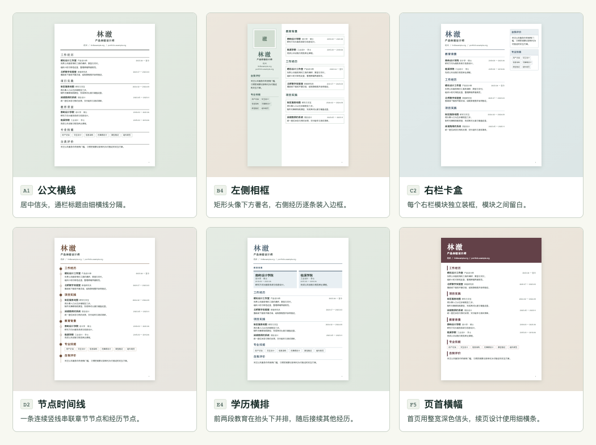

# 简历工坊 · 多模板库与样式切换需求

**本次交付是下一版的产品设计。** 目标是在同一份简历上自选 31 款 A4 版式。左侧继续维护原有字段、经历和要点，右侧按所选模板自动分页。已安装的 v1.0 使用「00 蓝灰圆弧」。原模板、两页基准和既有 PDF 的回归条件继续有效。

**先选看版式。** 用浏览器打开本地样张，在同一份虚构简历上试选、对照和应用。样张用于比较布局；下文的真实简历分页、保存、撤销、备份和 PDF 指标属于桌面版开发验收。[打开 31 款交互样张](template-gallery.html)

## 1. 从哪些设计取样

| 公开来源 | 页面可观察的做法 | 本产品如何使用 |
|---|---|---|
| CVwizard | Circular、Vertical、Horizontal、Classic、Metro 等模板各有纸张样张。Vertical 将不同类别并排，Metro 强化章节标题。[官方模板库](https://www.cvwizard.com/en/resume-templates) | 保留圆弧原稿，把主辅栏、章节标签和信息密度发展成可逐张辨认的版式。 |
| Resume.io | Corporate 使用时间线，Executive 使用多栏。编辑器从右侧预览上方打开模板选择器，选择器内可以翻看当前履历各页。[模板实样](https://resume.io/resume-templates) · [官方切换说明](https://help.resume.io/en/articles/3784960) | 提供年月轨与节点时间线。用户在选定前可检查自己的每一页，包括最后一页。 |
| Harvard Mignone Center for Career Success | 提供要点型与段落型简历范本。要点型样张以通栏分节，在条目右侧排列时间和地点。[范本目录](https://careerservices.fas.harvard.edu/resources/?ctag%5B%5D=resume-cv-cover-letter-templates&shared_category=student) · [要点型样张](https://cdn-careerservices.fas.harvard.edu/wp-content/uploads/sites/161/2024/07/resume-bullets.pdf) | 给长经历、校招或文字较多的简历提供宽正文、简洁标题的选择。 |
| Adobe Express | 卡片中可见黑白极简、瑞士网格、企业商务和摄影学生等表现方式。[官方图库](https://www.adobe.com/express/templates/resume) | 对照留白、页首、照片和强调区域；用统一虚构履历生成自己的样张。 |
| Europass | 先维护教育、工作和技能，再选入简历的资料及设计，同一档案可生成多份简历。[官方说明](https://europass.europa.eu/en/create-europass-cv) | 正文和模板布局分开保存；同一条经历的字段、层级和链接在所有样式间共享。 |

下面的编号、中文名称、取舍和切换规则都是简历工坊的设计。每款至少改变一个结构要素，如栏流、抬头、日期位置、导读区、项目组织或续页。配色、字号和行距是同一模板内的调节项。安装包自带样张、图形和字库，选款、预览和导出均可断网完成。

## 2. 模板目录与续页规格

图册分为原稿 1 款、正式单栏 5 款、左侧栏 5 款、右侧栏 5 款、时间履历 5 款、重点前置 5 款、编辑出版 5 款。

「右侧档案」的右栏是可接收用户拖入模块的独立栏；「日期页边」的右边只排日期，用户仍在一条正文流里拖动模块。下表的适用场景帮助选择，不限制投递职位。

| 编号 | 名称 | 首页排法与适用内容 | 翻页时怎么接 |
|---|---|---|---|
| 00 | 蓝灰圆弧 | 原版蓝灰侧栏约占纸宽 34%，圆形头像、个人资料在左，教育和经历在右；用于沿用现有成稿 | 两栏各自承接，末页保留弧线。原版两页基准的第二页从技能和第三段工作开始 |
| A1 | 公文横线 | 姓名居中，联系行在下；每个通栏章名下划细横线，适合正式投递和长要点 | 正文通栏承接，续页不重复大抬头 |
| A2 | 左题右文 | 左窄轨仅放栏目标题，右宽轨放该栏全部经历；连续阅读时可沿左边找章节 | 同章跨页在左轨标「栏目名（续）」，右侧接原文 |
| A3 | 双层信头 | 姓名和岗位上下排列，联络方式在右上独立换行，经历在下方通栏 | 联络区只占首页；次页从正文起排 |
| A4 | 台账条目 | 带日期的记录首行按年月、单位、职务对齐，说明占整行；便于对读多段任职或实习 | 新条目沿用列宽，跨页长说明承接原条目；缺失字段留给相邻列 |
| A5 | 边签索引 | 每章起点在页边放短竖签，右侧通栏排正文；适合栏目多、频繁跳读 | 仅章起点出现完整边签；跨页章用缩短的续签 |
| B1 | 全高名片 | 深底左栏放身份与辅助模块，右边集中展示经历；适合照片和个人资料较完整的简历 | 左底色延续，两个内容区各自续排，首页身份区只出现一次 |
| B2 | 半高色块 | 左上深底身份区与下方白底辅助模块相接，右栏从页首排正文；适合把身份与技能分开阅读 | 第二页左栏用白底，保留相同栏宽 |
| B3 | 左栏清单 | 无底色左栏用「标签／值」对齐，细竖线与主栏分开；适合工具、语言及联系方式较多的简历 | 按原标签宽度换行，各栏独立承接 |
| B4 | 左侧相框 | 矩形头像置于左栏框内，姓名在框下，右栏各段经历生成独立卡片 | 头像仅首页出现，过长卡片在下一页开口续接 |
| B5 | 通栏抬头左分栏 | 首页通栏展示姓名、岗位和联络行，下方左放辅助模块、右放主要经历；长姓名或长联络行可占满纸宽 | 第二页从双栏顶部起排，无通栏抬头占位 |
| C1 | 右侧档案 | 连续浅底右栏集中辅助资料，主正文在左；适合把任职内容放在第一阅读位置 | 两栏独立，右栏底色延续 |
| C2 | 右栏卡盒 | 右栏各模块单独成盒，卡盒之间留白，左边是连续经历 | 卡盒可跨页，续部分保留细框；空模块不出框 |
| C3 | 顶栏右名片 | 首行左放履历抬头，右上放头像和联络名片；下方为主栏和右侧栏 | 顶部名片仅在首页，次页保留双栏正文 |
| C4 | 右侧脚注 | 宽主栏配白底右栏，以短横线引出各组辅助资料；适合短技能、证书、语言 | 右栏续排自己的内容，不与左侧某一条经历强行对齐 |
| C5 | 中线双轨 | 两栏接近等宽，中间有竖线；适合教育、项目和经历都较充实的履历 | 各栏独立续排；左、右皆可接收模块 |
| D1 | 年月左轨 | 年月在左窄轨，右侧为职位或学校、说明与要点，便于快速核对任职时间 | 续页沿用相同缩进，日期仅随条目起点出现 |
| D2 | 节点时间线 | 带日期条目的起点画节点，以细线串起；要点从节点右侧展开 | 同条目跨页延续线，不为续文生成新任职节点 |
| D3 | 分段时间轴 | 教育、工作、项目各起独立时间轴，每组有自己的起止；适合多种经历并行 | 同章可续线，新章重新起轴 |
| D4 | 日期页边 | 正文从左向右通读，日期齐右落在页边专用轨；适合单位、职位名较长的履历 | 跨页保持同一正文宽度，新条目才打印日期 |
| D5 | 横带年表 | 每条有日期的经历都以横向日期带开头，再排职位和要点；适合任职阶段界限明显的经历 | 续文不重复横带；无日期的经历直接从标题开始 |
| E1 | 项目首屏 | 首页抬头下先展示首个可见项目的标题、时间、说明和要点；适合先让人读到代表项目 | 导读可自然续页，余下项目留在项目模块的队列中 |
| E2 | 概述题记 | 将首条可见自我评价排成引文式题记，接通栏经历；适合有完整职业概述的履历 | 长题记可跨页，余下评价按原序排 |
| E3 | 技能横条 | 在抬头下横排可见技能。短标签并排，带长说明的技能可占整行；适合强调专业能力 | 逐项换行、换页，保留技能说明与原顺序 |
| E4 | 学历横排 | 首两条可见学历并排，每条包含学校、专业、学位及日期；第三条起纵排 | 一条学历只占一个位置；超高卡片改为纵排；学历间强制分页时回到原教育模块 |
| E5 | 成果提要 | 首个可展示的项目要点在顶栏显示，附所属项目名，点击可定位原要点；适合先展示具体产出 | 提要打印一次，其余项目正文在原位置继续 |
| F1 | 期刊扉页 | 大字刊头配细分隔线，下接通栏小标题与正文；适合正文较长、强调阅读节奏的履历 | 续页保留细分隔，省去首页大字高度 |
| F2 | 研究目录 | 抬头下用可点击的短目录列出可见模块的入口，随后逐章排正文；适合科研、教学等多章节履历 | 目录只出现在首页，正文页标题仍从实际章节取值 |
| F3 | 案例档案 | 每个可见项目分配显示序号，独立编号轨与项目标题并排。首次采用时把项目模块排在正文首位，用户此后可拖动它；适合多个案例 | 长项目保持原编号，续文无新编号；隐藏、拖动后按可见顺序重算 |
| F4 | 对开履历 | 首页左右两块分别呈现身份与联络信息，下面回到通栏经历；适合希望抬头分区、正文较长的人 | 次页直接通栏，抬头的两块不生成独立续页栏 |
| F5 | 页首横幅 | 姓名与岗位放在整页宽深底横幅，正文在下方白底通栏；适合强调投递身份 | 续页用细条替代横幅，把高度留给正文 |

### 通用排版约定

- 模板有三种可拖动的正文区域组合：单一正文、主栏＋左侧栏、主栏＋右侧栏。A、D、E、F 的标题轨、日期轨、目录、横向卡组等都由字段自动生成。B 默认左辅、C 默认右辅。00 保持旧逻辑。E 组的首屏区域由内容类型决定，左侧标明被提取的原条目。
- 新模板的 A4 设计基线以毫米计。正文区域默认外边距 12 mm，双栏中缝 6 mm，B 组侧栏占扣除中缝后可用宽度的 30%，C1–C4 占 30%，C5 占 46%。A2、D1 的窄轨默认 28 mm，D4 日期轨 31 mm。新模板的页边距控件默认 12 mm，可调 8–20 mm，每档 0.5 mm。其余字号、行距等可调范围继承原规格；00 沿用自己的默认值和范围。打印的页码占页脚保留区。
- 带照款共五款。00、B1、B2、C3 使用圆形框，B4 使用矩形框，其余 26 款正文排版不设相框。各款使用同一原图和裁剪焦点，以等比缩放填满相框，框外部分裁掉。无照版释放照片占位，并提示「此款不显示照片，原图已保留」。头像未上传时收起空框，姓名和联络行前移；装饰色块只保留排文字所需的高度。
- 生成页首时复用可见字段，字段为空则收起该行及相邻分隔符。纸上标题仍尊重已有的自定义标题和「使用目标岗位」选项；姓名、目标岗位、联络行若已被抬头使用，其同一源字段不再进入正文。未被提取的联系行、自定义标签、模块引言和结语照常显示。装饰、目录、副标题里的上下文标签不生成新的内容对象。
- 文字量决定页数。章标题至少与首条内容的首行同页，项目名与第一行要点尽量同页；一条内容超过整页时允许逐行续排。日期轨、竖签、卡框不得挤掉字。超长网址先换行，有效链接沿用完整目标。双栏按各自剩余高度续排；同一页两栏都没有内容时移除空页。保留富文本、编号与父子缩进。
- E 组按源顺序选择可见且有内容的条目。E5 从首个可见项目向后找第一条有文字的叶子要点，其正文只在提要出现，所属项目用原名标注，原位保留其余兄弟要点。E4 只有一段学历时独占一行；无强制分页且卡片超高时在导读区改纵排后自然续页；两段学历之间有强制分页时取消首页提取，回到原教育模块按纵排和原分页标记展示。E 组遇到模块引言或手动分页与首屏提取冲突时，优先保留原叙述和分页位置，相关内容在原模块完整展示。候选差异区给出原因。缺少相应模块时收起导读区，抬头后直接排下一模块。
- 对 30 款新模板，抬头提取联系方式或岗位时也遵守原模块、条目及其祖先的显式分页和引言顺序。提取会越过这些约束时，该行留在原模块，抬头收起相应槽位并在差异说明中标明。00 延续原版抬头逻辑。
- F2 的首页目录最多两行三列，占高不超过 28 mm。六个以内列全；超过六个时列前五个，最后一格显示「另有 N 章」并跳到第六章。目录标签占一行，超长标签在目录里省略，正文保留完整标题。章节数量变化时刷新入口、目标与 PDF 内部链接。

## 3. 页面、控件与操作结果

### 3.1 入口和新建

| 位置 | 字段与控件 | 操作后的结果 |
|---|---|---|
| 已有简历的编辑器，右侧预览工具栏 | 「模板 · 蓝灰圆弧」、相邻的「排版」、页码、缩放 | 点「模板」打开选择器，保留光标所在字段 ID、正在看的经历和缩放。点「排版」调整已应用模板的字号等设置。 |
| 新建简历对话框 | 文档名、内容来源、模板、按钮「选择模板」「创建」 | 空白简历初始选中 00；从基准新建默认继承基准的模板。先选款再点「创建」才产生文档。空白内容在选择器用显式标注的虚构样张展示，创建后显示自己的空表单。 |
| 简历库 | 卡片或详情显示首页缩略图、已应用模板名和实际页数；保留「复制」 | 复制继承当前模板、其他使用过的模板设置及完整内容。要保留两个投递版本时，先复制，再给副本换模板。 |
| 文件导入或恢复 | 文件核对、创建／恢复、编辑器选款 | 普通 DOCX/PDF 核对后从 00 开始，可立即换款。恢复备份以档内模板与排版为准。简历库缩略图仅在创建或确认修改后更新。 |

### 3.2 选择器

| 区域 | 显示与动作 | 反馈与边界 |
|---|---|---|
| 标题区 | 「选择模板」、当前简历名、已应用模板；「关闭」 | 打开时焦点在当前卡，列表滚到该卡。关闭与「取消」等价，焦点回到编辑器的模板按钮。 |
| 筛选区 | 全部、系列、关键字；可按「单栏／左侧栏／右侧栏」和「显示照片」缩小集合。搜索匹配编号、中文名、系列和结构关键词 | 不同条件取交集。显示实际结果数；零项显示「没有符合条件的模板」和「清空筛选」。筛选不改变已应用模板。 |
| 卡片区 | 统一虚构数据绘制的本地首页小样、名称、栏型；标记「当前」或「预览中」 | 点击或键盘选中卡片只更新候选。样张中的照片和文字不取自用户文件。滚动列表不触发正文存储。 |
| 候选预览 | 用**正在编辑的整份简历**排出候选的全部页面。提供页码、「上一页」「下一页」、适应宽度与放大 | 分页时显示「正在排版」；算好后显示「当前 2 页 → 候选 3 页」等实测结果。可见数据只有一张照片而候选不带照时，仍允许选款，展示空白原因。 |
| 对比 | 「对比当前样式」显示「已应用／候选」两份页面，标题均标模板名和各自页数 | 默认从打开时正在看的经历开始，两边通过同一条目 ID 找页，页码可不同。任一侧手动翻页只改变该侧；点「对齐到此经历」重新对齐。空间不足以并排容纳两张可读纸张时改为「当前／候选」页签。 |
| 差异说明 | 实际页数；单栏↔双栏与辅栏方向；照片显示／收起；导读提取或回退；原手动分页影响的条目 | 显示能帮助决策的具体变化，如「技能从左栏移到正文」「第二段工作现从第 3 页开始」。只列发生变化的项目。点文字能定位相应页。 |
| 底部操作 | 「取消」「应用此模板」 | 选的就是当前款时，或候选排版中、失败时，「应用」禁用。失败显示「重新排版」和「取消」。确认应用成功后回到编辑器原经历，左侧表单内容与展开状态保留。 |
| 键盘操作 | Tab 在搜索、筛选、卡片、翻页、取消与应用之间移动；方向键在卡片内移动，Enter／空格试选，Esc 取消 | 对话期间焦点留在选择器内。卡片回车不直接改简历。只有在「应用此模板」按钮激活时回车才提交；状态变化同时提供文字。 |

离开当前字段后先提交已完成的中文输入，再取一份当前内存草稿用于候选试排。如果正在拼音组字，先接收组合结束事件。打开选择器前已输入的最后一个字即使正等待自动保存，也须出现在两边。选款期间锁定背景表单，点击遮罩不提交，窗口关闭按现有已编辑草稿的关闭流程处理。

### 3.3 从浏览到保存

1. **浏览。** 初始「已应用」为 A。点击 B，新增一个临时候选。用户再点 C 时，立即标出 C 正在排版；B 的迟到回调失效。打开过的候选不改变数据库、简历库缩略图、文档修改时间或撤销栈。打开前的正常自动保存可继续。
2. **取消。** 点「取消」、右上关闭或 Esc，丢弃当前试排，回到原文档位置。先前输入的字段与打开前一致；原页码在该字段仍在同一页时复原。再次打开，默认选中已应用款。
3. **应用。** 用户点「应用此模板」时检查文档 ID、草稿版本、模板 ID 和样式版次是否与当前候选一致。内容版本已变则用最新内容重排，告知「简历已更新，请核对后应用」。确认有效时一次性记入模板、布局和样式快照，更新两侧、页数、库缩略图，提示「已应用 ×× · 撤销」。重复点击只产生一次改动。
4. **保存与恢复。** 沿用「保存中／已保存／保存失败，重试」。磁盘写入失败时，候选已应用的草稿仍在内存，磁盘保留最后一次成功的整份简历。保留重试、备份及关闭时的未保存提示。失败后继续编辑再重试，保存最新完整草稿；迟到的旧写入不能覆盖新稿。
5. **撤销、重做、导出。** 切换本身占一步撤销，恢复上一款及其排序、间距和颜色。切换后再输字，第一次撤销该次输入，第二次撤销切换。重做按原操作顺序恢复。选择器中只供试排；确认后用编辑器、全屏或库的 PDF 导出已应用版面。导出等待最后一字保存、字体与照片就绪且最新分页完成。失败时提供重试并保留原文件。

## 4. 同一份内容怎样跨样式排放

| 问题 | 确定的行为 |
|---|---|
| 哪些改动是所有模板共用的？ | 修改文字、日期、顺序号、联系方式、岗位、语言、富文本、超链接、隐藏状态、照片和原图裁剪；条目在模块内换序、子项目或要点在父项内换序；新增、删除及各级显式分页标记。都根据同一内容 ID 更新。拖整条经历时后代随行。 |
| 哪些改动按这份简历和这个模板分别记住？ | 模块放哪一栏及栏内顺序、字号、字体、边距、颜色、行高、段／项／模块间距、页码开关。首次试用新模板用该款默认值；重新使用已有模板恢复上次应用的排列和覆盖值。预览缩放、滚动、筛选不计入文档排版。 |
| 双栏切双栏的首次映射 | 保留来源的主栏／辅栏成员和栏内顺序。目标辅栏在右时，整组移到纸张右侧。用户曾把某个自定义模块拖到辅栏，它随辅栏一起移。左侧编辑器的区域名显示「主栏（左）／侧栏（右）」等实际方向。 |
| 双栏切单栏的首次映射 | 先按照模板规则投放抬头字段。正文取来源主栏模块的现有顺序，再接来源辅栏的剩余模块，隐藏项参与顺序映射，在表单中仍可重新显示。F3 首次映射后把项目模块移到正文开头。目录、年月轨或标签轨只作视觉位置。左侧只提供「正文」一个可拖放区域，绝不出现可投递模块的假日期栏。 |
| 单栏切到未用过的单栏款 | 继承来源正文中所有模块的相对顺序，包含隐藏项。F3 首次排序时将项目模块移到开头；多个项目模块维持彼此顺序。E 系列的首屏提取只改变展示位置，不改变保存的模块顺序。 |
| 单栏首次切到未用过的双栏款 | 默认个人信息、目标、评价、技能、语言入辅栏；教育、工作、项目、签名、自定义入主栏。各组沿用单栏中的相对次序。若目标款已有记录，一律优先用它上次保存的布局。 |
| 切回旧款时出现新增或删掉的模块 | 原来存在的 ID 按该款保存的栏位、顺序回到原处。新增模块按类型入默认栏，跟在该栏上一个仍存在的同类模块后；没有同类则入栏末。删除的 ID 清理，隐藏的 ID 保留槽位。模块恢复显示后回到记忆位置。 |
| 手动分页 | 模块、经历、正文块三层标记均绑定对象。在目标模板中，标记让该对象从所属逻辑栏的下一页开始；单栏时作用于唯一正文流。遇到页首已有换页、同一首行承接多层标记或空前页，只产生一次有效分页。隐藏对象的标记休眠。 |
| 重置、复制与独立版本 | 「恢复本模板默认排版」只重置当前款的八类样式控件和页码设置，手工栏位顺序继续保持；动作可撤销。复制简历后有独立内容 ID，所有按 ID 保存的栏位、顺序、分页、提取关系同步重映射。新副本后续操作与原件独立。 |

**一条可以手工走通的例子。** 在 00 将自定义「证书」拖到左栏的「技能」之后，再选 A1。首次试排时先看到主栏的教育、工作、项目，再在正文后部看到技能和证书。应用 A1，把「证书」拖到「教育」前；在工作条目中补一句话。切回 00 后，证书回到左栏技能之后，补的那句话仍在工作条目。再次选 A1，证书回到教育前。两份 PDF 可以有不同页数，两者均包含补写的句子。

## 5. 与现有工程衔接

| 部位 | 开发约定 |
|---|---|
| 文档与模板注册表 | 新版文档保存当前固定模板 ID、版次、各已确认模板的样式覆盖和按区域排序的模块 ID。注册表描述区域、阅读顺序、首页／续页几何、照片策略、提取及缺省回退规则；颜色不是模板主键。内置各历史版次的排版定义，避免应用更新后旧 PDF 静默换样。 |
| v1 文件与数据库 | v1 文档、基准 seed 和旧备份缺模板标识时绑定 00 初始版次，保留原样式的每个数值、原来两栏和顺序。首次持久化前完成格式检验，数据库事务一次升级；失败可从原记录重试。遇到新于本机且无法识别的备份，说明所需版本、保留文件，禁止自动覆盖为 00。 |
| 编辑、分页、渲染 | 当前模型只给模块保存 side/main，编辑器固定展示左右两组，分页器也使用固定两栏尺寸。下一版由同一模板定义驱动表单落点、文字测量、分栏、续页、装饰和打印。输出每页的区域、矩形、内容 ID 及页码映射，缩略图、主预览、全屏和 PDF 共用。 |
| 候选与导出隔离 | 每次试选的任务持有简历 ID、草稿版本、模板 ID、模板版次、样式指纹和任务序号。仅最后一个有效任务可启用「应用」。确认后 PDF 请求须匹配已保存修订和相同的布局指纹。临时候选页面不进打印根节点。 |
| 空内容与回填 | 有无可打印内容以当前模板最终的可见源内容为准。仅有一张照片又选无照款时提示「当前模板没有可导出的内容，可换带照模板或补充文字」。删除长内容后两栏分别向前回填，自动移除末尾空页。 |
| 响应与本地数据 | 卡片使用小型本地示例图；只给所选项和当前对比项运行真实简历分页。候选数据留在内存，模板库不上传内容。键盘和屏幕阅读器能读出当前款、候选名、实际页数与主要变化。 |

## 6. 开发验收单

下列 T01–T15 是开发完成后要运行的场景。HTML 原型可以确认外观和选款流程；它不产生此表所要求的桌面验收结果。

| 编号 | 实际操作 | 通过标准 |
|---|---|---|
| T01 数量与结构 | 断网打开模板库，逐张检查目录与首／续页基准 | 共 31 个唯一 ID，00 加六组各五款；每款能匹配目录规定的可观察结构。单栏筛出 20 款，左侧栏（含 00）筛出 6 款，右侧栏筛出 5 款，带照筛出 5 款。只换主题色不能增加计数。 |
| T02 筛选与键盘 | 输入模板名、编号、结构关键词；叠加栏型与照片筛选，清空空结果；只用键盘选款并取消 | 计数与卡片一致。Esc 还原，焦点可见；误按卡片回车不会应用。 |
| T03 试选与取消 | 在工作要点末尾输入汉字后立即打开；按 A→B→C 快速点击并模拟 B 晚到，随后取消 | 每侧都含最后一个字。只有 C 能成为可应用候选；无试选导致的写库、修改时间、撤销或缩略图变更。 |
| T04 对比与位置 | 用跨两页的样本试到三页款，查看同一段工作及最后一页；缩窄窗口 | 两边显示各自实测页数，以同一 ID 对齐。候选末页可看，窄窗页签保留所看的位置。 |
| T05 应用与撤销 | 应用 A1，编辑一条要点，依次撤销两次、重做两次；应用按钮双击 | 每个动作只占一步。两个方向都能还原正文、模板、栏位、样式和分页。 |
| T06 栏位往返 | 按第 4 节证书示例操作，再试左辅→右辅；返回前新增和删除模块 | 自定义模块、模板内排序、新字段都在正确位置；隐藏模块能恢复，单栏无第二个模块落点。 |
| T07 任意两款 | 用含所有模块、嵌套子项目、长中英文和链接的虚构简历运行 31 × 30 个有向切换，再返回来源款 | 共 930 组。正文树、源 ID、日期、父子关系、隐藏标记、分页标记、照片裁剪、富文本逐字段相等；各款已保存的位置和样式按快照恢复。 |
| T08 特殊版面 | E1–E5 分别试缺模块、首项隐藏、超长条目、引言、手动分页；F2 增加至九个模块后点击第六格、F3 重排，A4 留空字段 | 首页提取与正文可见源内容合计完整且仅一次；上下文标签和目录单独计。空导读收起，序号和锚点稳定，无孤立装饰、空卡片或截断文字。 |
| T09 照片与源字段 | 有照→无照→有照，核验裁剪旋转；仅照片文档试无照款；增加长邮箱、自定义联系行 | 还原原有照片取景，隐藏时无空框；空导出获明确提示；所有可见联系行完整，点预览可定位到左侧原字段。 |
| T10 分页与 PDF | 31 款各导出一份长样本，逐页栅格对比同一预览，提取中英文和链接；工作要点扩写后删回 | 纸张为 A4，纸面关键位置偏差 ≤1 mm；页数一致，PDF 正文可搜、外链有效，F2 的目录项可跳到正确的章节页。按逻辑阅读顺序检查抽取文字；各级分页符有效，新增页可回填。 |
| T11 兼容与备份 | 打开 v1 数据库、恢复旧备份、复制含多款布局的新文档；重启后重新选旧款 | 00 保留原两页基准及样式；副本 ID 不冲突，所有布局引用有效；新格式备份往返后，非当前款的设置也可恢复。 |
| T12 保存与并发 | 模拟写失败，继续输入并重试；快速确认后马上导出；模拟候选排版错误 | 旧磁盘记录完整，重试保存最新草稿，导出只含已应用版面。候选失败可重试或取消，未产生半个布局。 |
| T13 离线与性能 | Apple Silicon 打包版本断网，字体预热后用两页基准采样至少 50 次输入、全局重排及选款 | 普通输入到更新 P95 ≤200 ms；全局重排 P95 ≤500 ms；选款到真实两页候选及页数就绪 P95 ≤800 ms。记录机型、数据量、采样时间和 P95。 |
| T14 管理／新建 | 从空白、基准、文件导入、恢复备份分别进入；未确认时退出新建；复制后给副本换款 | 各入口模板取值符合 §3.1；取消不产生文档，副本单独更新，重启后库缩略图、详情和编辑器显示同款。 |
| T15 原版回归 | 用本机原稿运行既有 A01–A16；另用虚构数据覆盖全部 31 款，检查字体、隐藏项、PDF 和断网启动 | 00 的旧版版式和两页换栏锚点通过，其他模板按各自分页验收。公开样张、测试夹具和报告只含虚构资料。 |

需求关联：[v1 产品规格](requirements.md) · [v1 验收记录](acceptance.md) · [模板库交互样张](template-gallery.html)
